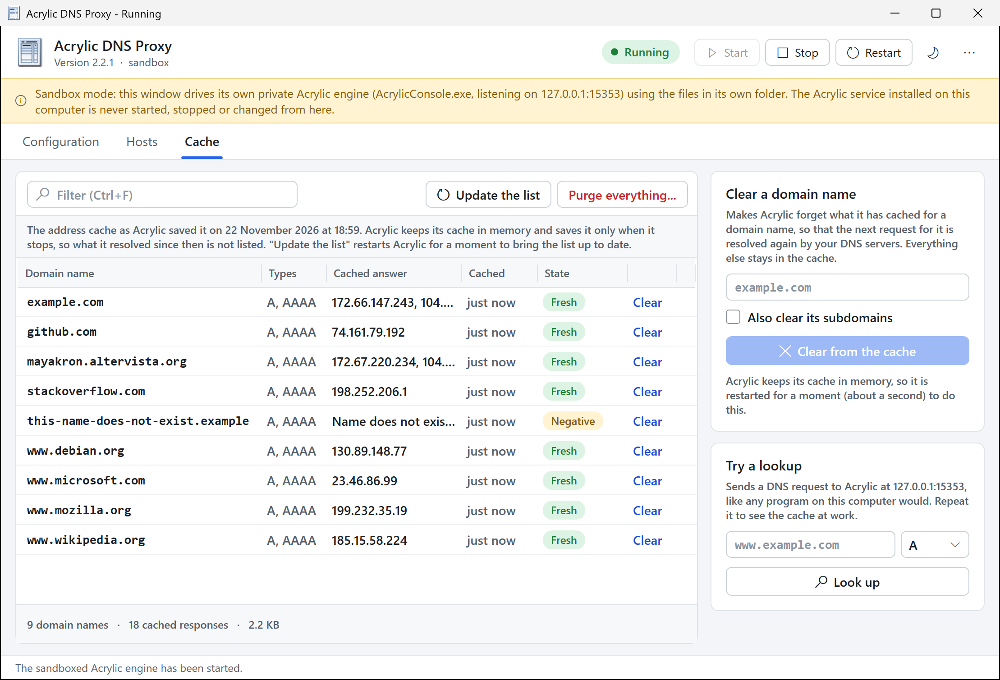
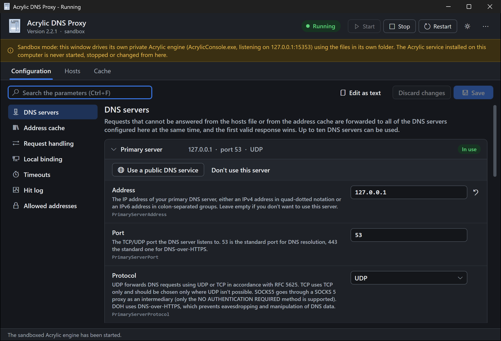
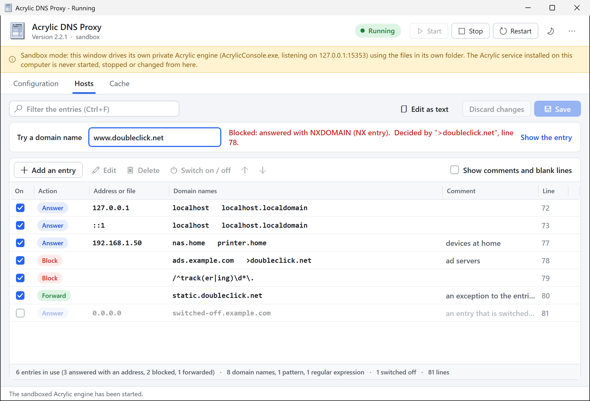

# Acrylic UI

A new desktop application for [Acrylic DNS Proxy](https://mayakron.altervista.org/support/acrylic/Home.htm), replacing
the Acrylic UI it is distributed with. This repository holds the UI only: Acrylic itself is not here and is not changed.

## What it does

- **Configuration tab.** Every parameter of `AcrylicConfiguration.ini`, grouped by category, with search, validation
  and reset to default. Saving rewrites only the lines that changed: comments and layout stay as they are.
- **Hosts tab.** `AcrylicHosts.txt` entry by entry: add, edit, switch off, reorder, delete. "Try a domain name" tells
  which entry decides the answer for a name.
- **Cache tab.** Lists what Acrylic has cached and clears a single domain name (or several, or a name with its
  subdomains), leaving the rest of the cache alone.
- **Light and dark appearance**, or the one chosen in the Windows settings.
- Starts, stops and restarts the Acrylic service; both files can also be edited as plain text.

## Using it

Build it (see below) and put `AcrylicUI.exe` in the folder Acrylic is installed in, next to `AcrylicService.exe`. It
works on the files of the folder it is in, and it only manages an Acrylic service that runs from that same folder.

It understands the command line options of the Acrylic UI it replaces (`InstallAcrylicService`,
`StartAcrylicService`, `PurgeAcrylicCacheData` and so on), so the batch files Acrylic comes with keep working.

To try it without touching an installed service, put it in a folder of its own together with `AcrylicConsole.exe`,
`AcrylicConfiguration.ini` (with `LocalIPv4BindingPort` set to something other than 53), `AcrylicHosts.txt` and an
empty file named `AcrylicSandbox.txt`. It then drives that private console instead of the service.

## Things to know

- Written in C# (WPF) for the .NET Framework 4.7.2, which is included in Windows 10 (version 1803 or later) and in
  Windows 11. Made for Acrylic 2.2.1.
- Acrylic keeps its address cache in memory and saves it only when it stops, so clearing a domain name restarts
  Acrylic for about a second. If the cache is configured to live in memory only, single names cannot be cleared.
- Acrylic reads its files when it starts: after saving, the UI offers to restart it.

## Building

| What | How |
| --- | --- |
| The UI | `dotnet build AcrylicUI\AcrylicUI.csproj -c Release` (needs the .NET SDK) |
| Its self-checks | `dotnet run --project AcrylicUI.Tests` |

`AcrylicUI.Tests\Data` holds a copy of the two files Acrylic 2.2.1 is distributed with, which the self-checks read.

## License

GNU General Public License, like Acrylic: see [License.txt](License.txt).